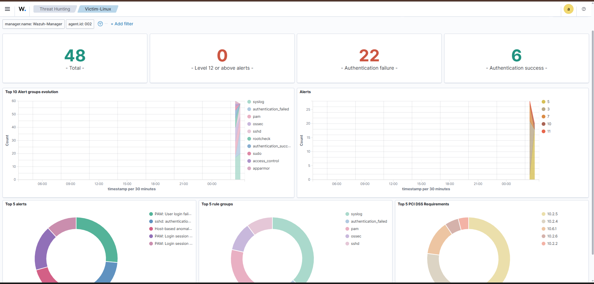
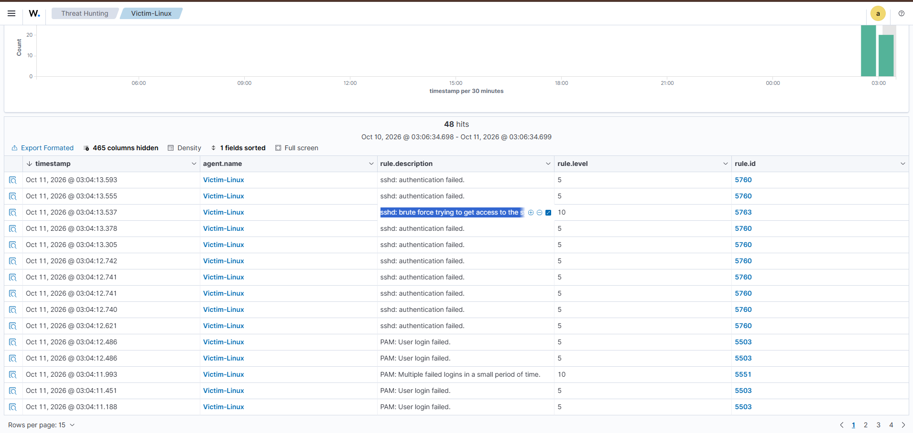
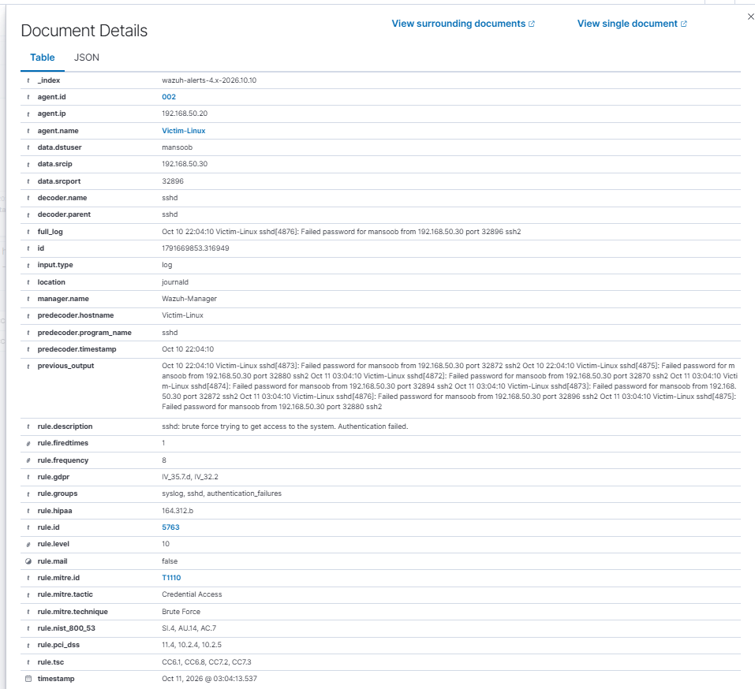

# Incident Report: SSH Brute Force Against Victim-Linux

| Field | Detail |
|---|---|
| Report ID | IR-2026-001 |
| Analyst | Mansoob Iqbal |
| Severity | High (Wazuh rule level 10) |
| Category | Credential Access |
| MITRE ATT&CK | T1110 Brute Force (Tactic: Credential Access) |
| Status | Detected using built-in Wazuh rules |

---

## 1. Summary

A password-guessing attack against the SSH service of `Victim-Linux` (`192.168.50.20`) was launched from the attacker machine (Kali, `192.168.50.30`) in an isolated home lab. Wazuh detected the repeated failed logins using its built-in SSH rules and raised a level 10 alert ("sshd: brute force trying to get access to the system. Authentication failed."). The alert was automatically mapped to MITRE ATT&CK technique T1110.

No custom rule was needed for this attack. The built-in ruleset covers it.

## 2. Environment

| Component | Detail |
|---|---|
| SIEM | Wazuh 4.9.2 (manager, indexer, dashboard), `Wazuh-Manager` |
| Monitored host | `Victim-Linux`, Ubuntu 22.04, OpenSSH server, Wazuh agent ID 002, `192.168.50.20` |
| Attacker | Kali Linux, `192.168.50.30` |
| Network | VirtualBox Internal Network `labnet`, isolated from production |

## 3. Attack Simulated

- Tool: Hydra
- Command: `hydra -l mansoob -P /tmp/mini-pass.txt ssh://192.168.50.20`
- Target account: `mansoob`
- Wordlist: a small custom list (`123456`, `password`, `admin`, `qwerty`, and the account's real password, included on purpose so the attack could succeed and the full detection chain could be observed)

## 4. Detection

Wazuh's built-in SSH rules fired without any custom configuration:

| Rule ID | Level | Description |
|---|---|---|
| 5760 | 5 | sshd: authentication failed |
| 5763 | 10 | sshd: brute force trying to get access to the system. Authentication failed. |

Rule 5763 is a correlation rule. It fires when the same source produces repeated failures within a short time (`rule.frequency: 8` in the alert).

Dashboard summary for the test period (Threat Hunting, filtered to agent 002):

- 48 total alerts
- 22 authentication failures
- 6 authentication successes

## 5. Evidence

| Item | Value |
|---|---|
| Rule | 5763, level 10 |
| Source IP | `192.168.50.30` |
| Target user | `mansoob` |
| Log source | `journald` on Victim-Linux (sshd) |
| Pattern | Many `Failed password for mansoob from 192.168.50.30` lines in a few seconds |
| MITRE | T1110, Credential Access, Brute Force |

Sample log line from the alert:

```
Oct 10 22:04:10 Victim-Linux sshd[4876]: Failed password for mansoob from 192.168.50.30 port 32896 ssh2
```

**Figure 1.** Dashboard summary: alert counts, authentication failures and successes



**Figure 2.** Events list for the victim agent



**Figure 3.** Alert details for rule 5763 with MITRE mapping `T1110`, Credential Access, Brute Force



## 6. Analysis

The pattern matches an automated online password attack: a single source IP, a single target account, many failed SSH logins in a very short time, and a rapid rate of attempts that a human typing passwords could not produce.

The dashboard also shows authentication successes during the test period. Because the real password was deliberately included in the wordlist, a successful login is expected in this simulation. In a real incident, a success that follows a burst of failures from the same source is the most dangerous signal, because it means the attacker may now have access to the account. The individual success events were not reviewed one by one for this report.

## 7. Known Limitations

- The built-in rules detect the attack, but nothing links "many failures" to "then a success from the same IP" in a single alert. An analyst has to correlate these manually.
- Detection depends on the Wazuh agent forwarding sshd logs correctly. If the agent stops, the attack is invisible.

## 8. Recommendations

1. **Disable password logins for SSH** and use key-based authentication. This removes the attack surface entirely.
2. **Rate-limit or ban repeat offenders** with a tool such as `fail2ban`, or with Wazuh active response, so the source IP is blocked after several failures.
3. **Restrict SSH access** to known source IPs or a management network.
4. **Add a correlation rule** that raises a higher severity alert when rule 5763 is followed by an SSH authentication success (rule 5715) from the same source IP.
5. **Enforce strong passwords or MFA** for all accounts that can log in over SSH.
6. **On a real compromise:** reset the account password, review `auth.log` for the session after the successful login, and check for persistence (new users, keys, cron jobs).

## 9. Lessons Learned

Built-in SIEM rules already cover common attacks such as SSH brute force, and they come with MITRE mapping. The value an analyst adds is in confirming the detection with a real simulation, reading the alert, and recommending a fix. The contrast with the Nmap scan (IR-2026-002), which needed a custom rule, shows how to tell which attacks the defaults already cover and which they miss.
