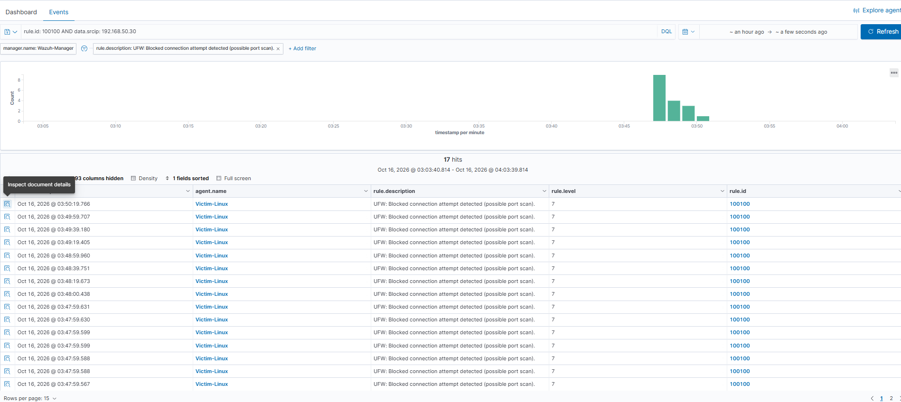
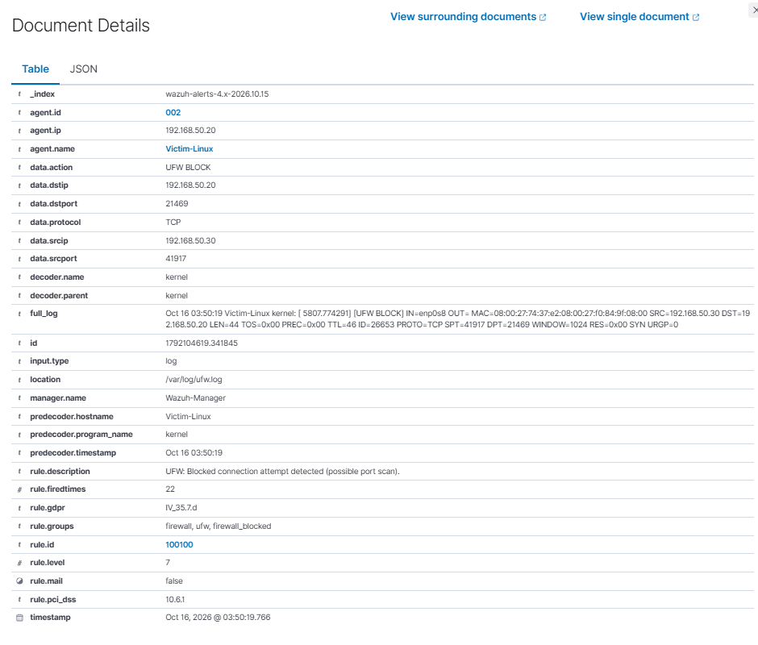
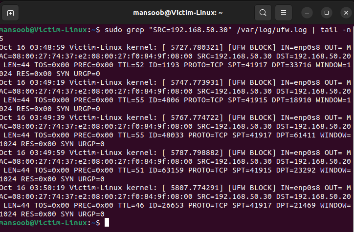
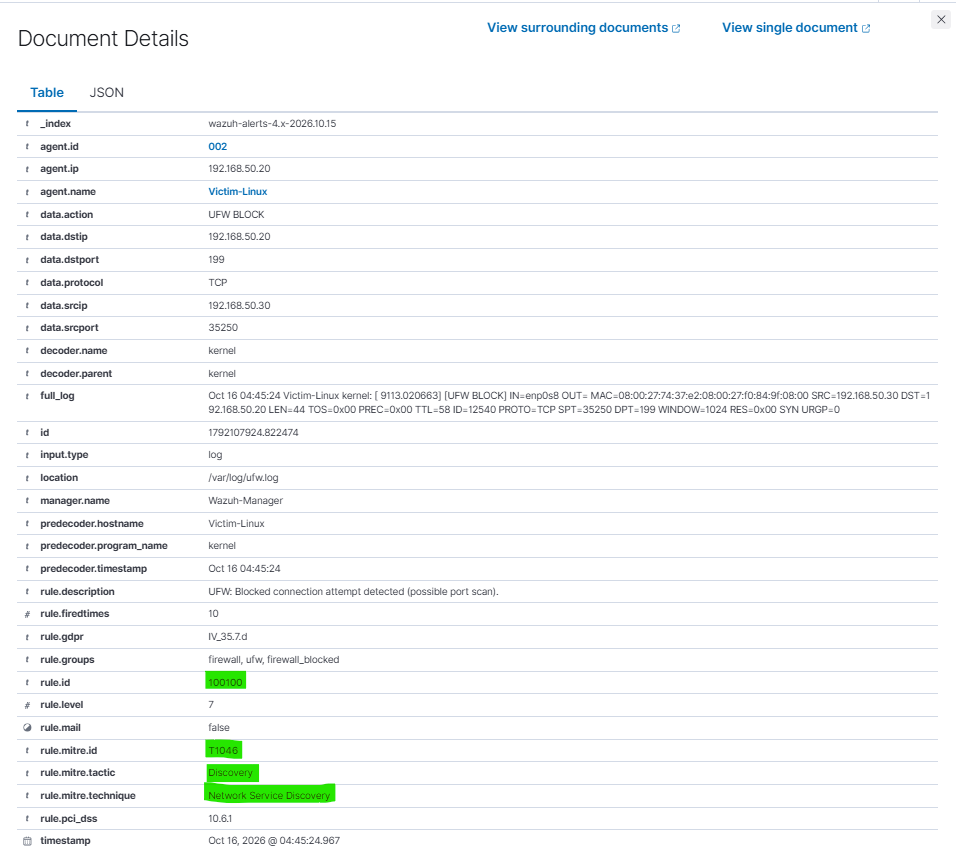

# Incident Report: Network Port Scan Against Victim-Linux

| Field | Detail |
|---|---|
| Report ID | IR-2026-002 |
| Analyst | Mansoob Iqbal |
| Severity | Medium (Wazuh rule level 7) |
| Category | Reconnaissance / Discovery |
| MITRE ATT&CK | T1046 Network Service Discovery (Tactic: Discovery) |
| Status | Detected, investigated, detection rule tuned with MITRE tag |

---

## 1. Summary

A TCP port scan from the attacker machine (Kali, `192.168.50.30`) was run against the monitored host `Victim-Linux` (`192.168.50.20`) in an isolated home lab. The default Wazuh ruleset did **not** raise an alert for the scan. After enabling firewall logging on the victim and writing a custom detection rule (ID `100100`), the scan was detected and each blocked probe generated a level 7 alert in the Wazuh dashboard.

This report covers the detection gap, the fix, and the evidence that the fix works.

## 2. Environment

| Component | Detail |
|---|---|
| SIEM | Wazuh 4.9.2 (manager, indexer, dashboard), `Wazuh-Manager` |
| Monitored host | `Victim-Linux`, Ubuntu 22.04, Wazuh agent ID 002, `192.168.50.20` |
| Attacker | Kali Linux, `192.168.50.30` |
| Network | VirtualBox Internal Network `labnet`, isolated from production |

## 3. Attack Simulated

- Tool: Nmap
- Commands: `nmap -p- 192.168.50.20` (full TCP port range), later `nmap -p 1-1000 192.168.50.20` (re-test after the rule was updated)
- Source: `192.168.50.30`
- Target: `192.168.50.20`

## 4. Detection Gap (Before)

Wazuh is a host-based tool. A plain Nmap scan produced no useful alert on its own. Even after UFW logging was enabled on the victim, the resulting `[UFW BLOCK]` kernel log lines only matched the generic rule **4100** ("Firewall rules grouped", level 0), which does not create a visible alert.

**Finding:** the lab had no detection for network reconnaissance.

## 5. Remediation: Custom Detection

**Step 1. Make the scan visible in logs (Victim-Linux)**

```bash
sudo ufw enable
sudo ufw logging on
sudo ufw default deny incoming
sudo ufw allow ssh
```

`/var/log/ufw.log` was added to the agent's `ossec.conf` as a `<localfile>` so the Wazuh agent forwards it to the manager.

**Step 2. Custom rule (Wazuh-Manager, `/var/ossec/etc/rules/local_rules.xml`)**

```xml
<group name="firewall,ufw,">

  <rule id="100100" level="7">
    <if_sid>4100</if_sid>
    <action>UFW BLOCK</action>
    <description>UFW: Blocked connection attempt detected (possible port scan).</description>
    <mitre>
      <id>T1046</id>
    </mitre>
    <group>firewall_blocked,pci_dss_10.6.1,gdpr_IV_35.7.d,</group>
  </rule>

</group>
```

**Debugging notes (what did not work)**

- `<decoded_as>ufw</decoded_as>` failed, because the built-in `kernel` decoder already matches these lines.
- `<field name="action">` failed with "Field 'action' is static", because `action` is a reserved field.
- The working approach is the dedicated `<action>` tag combined with `<if_sid>4100</if_sid>`.

**Step 3. Validation with `wazuh-logtest`**

A sample `[UFW BLOCK]` line was tested. Phase 3 returned `id: 100100`, `level: 7`, MITRE `T1046` (Discovery), and "Alert to be generated."

## 6. Evidence

| Item | Value |
|---|---|
| Rule | 100100, level 7, "UFW: Blocked connection attempt detected (possible port scan)." |
| Alerts in first run | 17 (filter: `rule.id: 100100 AND data.srcip: 192.168.50.30`) |
| Source IP | `192.168.50.30` |
| Destination IP | `192.168.50.20` |
| Protocol | TCP, SYN packets |
| Destination ports | Different random port in each alert (for example 21469, 199), typical of a port scan |
| Log source | `/var/log/ufw.log` on Victim-Linux |
| MITRE (after tagging) | T1046, Discovery, Network Service Discovery |

Sample log line that triggered the rule:

```
Oct 16 03:50:19 Victim-Linux kernel: [ 5807.774291] [UFW BLOCK] IN=enp0s8 OUT= ... SRC=192.168.50.30 DST=192.168.50.20 LEN=44 ... PROTO=TCP SPT=41917 DPT=21469 WINDOW=1024 RES=0x00 SYN URGP=0
```

Screenshots:

**Figure 1.** Dashboard: rule 100100 alerts from `192.168.50.30` (17 hits)



**Figure 2.** Alert details: source and destination IP, ports, full log line



**Figure 3.** Raw firewall log on Victim-Linux (`/var/log/ufw.log`) showing the scan packets



**Figure 4.** Alert after MITRE tagging: `T1046`, Discovery, Network Service Discovery



---

## 7. Analysis

The pattern is consistent with automated port scanning: one source IP, many different destination ports, SYN-only packets, and a high rate of blocked attempts in a short time. The scan was blocked by the host firewall and no service was reached. No evidence of follow-up exploitation was found.

## 8. Known Limitations

- Rule 100100 fires on **every** `UFW BLOCK` event. Internet noise on the NAT adapter (for example blocked return traffic from external servers) can also trigger it, which produces false positives.
- The rule alerts per packet, not per scan, so one scan produces many alerts.

## 9. Recommendations

1. **Reduce noise:** restrict the rule to the internal interface or internal source range, or exclude known external IPs.
2. **Alert on the behavior, not each packet:** use `frequency` and `timeframe` so one alert fires after N blocks from the same source within a time window.
3. **Respond:** block the source IP automatically for repeated scans (Wazuh active response).
4. **Reduce exposure:** keep default-deny inbound and expose only required services.
5. **Extend coverage:** forward firewall logs from network devices, not only hosts, so scans are visible across the whole subnet.

## 10. Lessons Learned

Default detections do not cover every attack stage. A SIEM is only as good as its log sources and rules, so validating detections with real attack simulation and writing custom rules where gaps appear is part of the analyst workflow.
