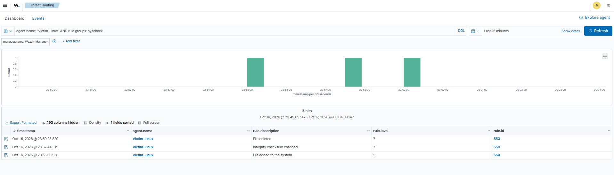
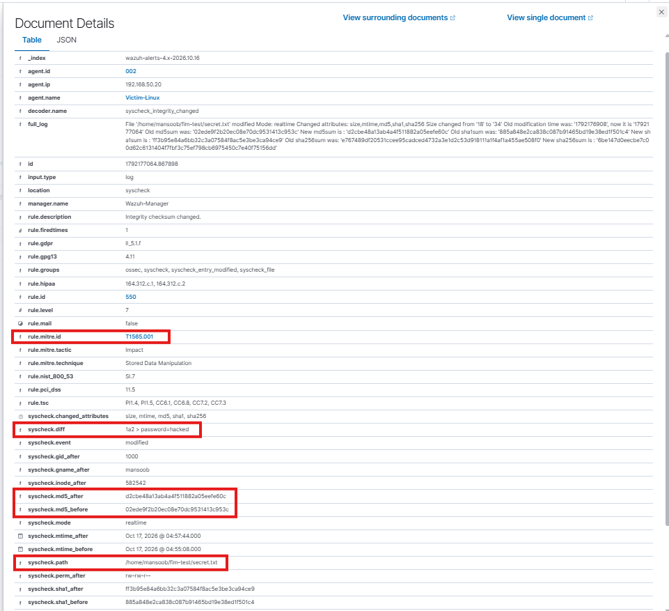

# Incident Report: File Tampering Detected by File Integrity Monitoring

| Field | Detail |
|---|---|
| Report ID | IR-2026-003 |
| Analyst | Mansoob Iqbal |
| Severity | Medium (Wazuh rule level 7) |
| Category | Impact / Data Integrity |
| MITRE ATT&CK | T1565.001 Stored Data Manipulation (Tactic: Impact) |
| Status | Detected using built-in Wazuh rules |

---

## 1. Summary

A file inside a monitored directory on `Victim-Linux` (`192.168.50.20`) was created, modified and deleted. Wazuh's File Integrity Monitoring (the `syscheck` module) detected all three actions in real time and raised one alert per action. The modification alert showed exactly what changed, including the added line, the file size change and the before and after hashes.

This test covers the **post-compromise** stage: what an analyst sees after an attacker has already gained access to a host and starts changing files.

## 2. Environment

| Component | Detail |
|---|---|
| SIEM | Wazuh 4.9.2 (manager, indexer, dashboard), `Wazuh-Manager` |
| Monitored host | `Victim-Linux`, Ubuntu 22.04, Wazuh agent ID 002, `192.168.50.20` |
| Monitored path | `/home/mansoob/fim-test` |
| Network | VirtualBox Internal Network `labnet`, isolated from production |

## 3. Setup

Real-time monitoring of one test directory was enabled in the agent configuration (`/var/ossec/etc/ossec.conf` on Victim-Linux), after backing up the original file:

```xml
<syscheck>
  <directories realtime="yes" check_all="yes" report_changes="yes">/home/mansoob/fim-test</directories>
  ...
</syscheck>
```

- `realtime="yes"`: changes are reported immediately instead of waiting for the next scheduled scan.
- `check_all="yes"`: size, permissions, owner, modification time and hashes (MD5, SHA1, SHA256) are all tracked.
- `report_changes="yes"`: the alert includes a text diff of what changed.

The agent was restarted to load the new configuration.

## 4. Activity Simulated

The activity was run **locally on Victim-Linux** (not from the attacker machine) to simulate what an attacker could do after gaining access:

```bash
echo "password=admin123" > /home/mansoob/fim-test/secret.txt    # create file
echo "password=hacked" >> /home/mansoob/fim-test/secret.txt     # modify file
rm /home/mansoob/fim-test/secret.txt                            # delete file
```

Because the activity was simulated locally, this report shows the detection of file tampering only. It does not claim a remote attacker made these changes.

## 5. Detection

No custom rule was needed. Wazuh's built-in syscheck rules fired:

| Rule ID | Level | Description | Action |
|---|---|---|---|
| 554 | 5 | File added to the system | File created |
| 550 | 7 | Integrity checksum changed | File modified |
| 553 | 7 | File deleted | File deleted |

## 6. Evidence

Details of the modification alert (rule 550):

| Field | Value |
|---|---|
| `syscheck.path` | `/home/mansoob/fim-test/secret.txt` |
| `syscheck.event` | modified |
| `syscheck.mode` | realtime |
| `syscheck.diff` | `1a2 > password=hacked` (a second line was added) |
| Size | changed from 18 to 34 bytes |
| Hashes | MD5, SHA1 and SHA256 all changed (before and after values recorded) |
| `rule.mitre.id` | T1565.001 |
| `rule.mitre.tactic` | Impact |
| `rule.mitre.technique` | Stored Data Manipulation |

**Figure 1.** Dashboard: three syscheck alerts (file added, checksum changed, file deleted)



**Figure 2.** Modification alert (rule 550) with the diff, hashes and MITRE mapping



## 7. Analysis

The three alerts, one per action, match the three commands exactly. The diff and the hash change prove the file content was altered, not just touched. In a real incident this is what lets an analyst answer "what was changed, and when" for sensitive files such as configuration files, SSH keys or web content.

An important point is that FIM only sees activity **after** access has been gained. It complements the earlier detections: the SSH brute force (IR-2026-001) shows how access could be obtained, and this report shows what the host can reveal afterwards.

## 8. Known Limitations

- Only the configured directory is watched. Changes anywhere else are invisible.
- `report_changes="yes"` stores file content in the alert. In this test the diff showed `password=hacked`. On real systems this can leak secrets into the SIEM, so it should be used only on files that do not contain sensitive data.
- An attacker with root access could stop the agent or edit its configuration. FIM is not tamper-proof on its own.
- The test used one small file. Busy directories (logs, temp files) would create alert noise that needs tuning.

## 9. Recommendations

1. **Monitor critical paths:** for example `/etc` (especially `passwd`, `shadow`, `sudoers`), `~/.ssh/authorized_keys`, cron directories and web roots.
2. **Avoid `report_changes` on sensitive files** so secrets are not copied into alerts.
3. **Correlate alerts:** treat a file change that follows a brute force alert from the same environment as higher priority.
4. **Protect the agent:** restrict who can stop the Wazuh agent or edit its configuration, and alert if the agent goes offline.
5. **Respond to a real tampering alert:** isolate the host, compare the file against a known good copy, check who was logged in at the time, and restore from a trusted backup.

## 10. Lessons Learned

Built-in FIM turns "a file changed" into clear evidence: path, diff, size and hashes. Detection coverage depends on choosing the right paths to watch, so the configuration matters as much as the tool.
